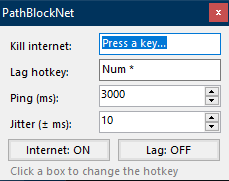
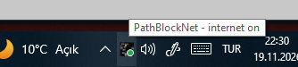

PathBlockNet

small tray app for windows that can cut your internet or add fake ping with a hotkey. made it mostly for testing how stuff behaves on a bad connection, and because disabling the adapter every time was annoying.



this is the panel, opens when you left click the tray icon. the icon also changes color, green is normal, yellow means lag is on, red means internet is cut.



- cuts internet with one key (adds windows firewall rules, removes them when you turn it off or exit)
- fake ping on outgoing packets using WinDivert, with a jitter option so it isnt a flat line
- keeps packet order so tcp doesnt freak out
- custom hotkeys, ctrl/alt/shift combos work too
- saves settings to PathBlockNet.ini
- plays fnaf sounds when you toggle stuff lol

default keys are Num / for internet and Num * for lag. you can change them from the panel, click the box and press a key (esc cancels).

to use it just keep WinDivert.dll and WinDivert64.sys next to the exe and run it, it needs admin. right click the tray icon for settings or exit.

if you want to build it yourself you dont need visual studio, the compiler that comes with .net framework works:

```
C:\Windows\Microsoft.NET\Framework64\v4.0.30319\csc.exe -nologo -target:winexe -platform:x64 -win32manifest:PathBlockNet.manifest -resource:images.jpg,images.jpg -r:Microsoft.CSharp.dll -out:PathBlockNet.exe PathBlockNet.cs
```

if it crashes while internet is cut just open it again, it cleans the old firewall rules on startup. only tested on win10 x64.

dont use this in online games, youll probably get banned.

thanks to basil00 for WinDivert https://github.com/basil00/WinDivert
